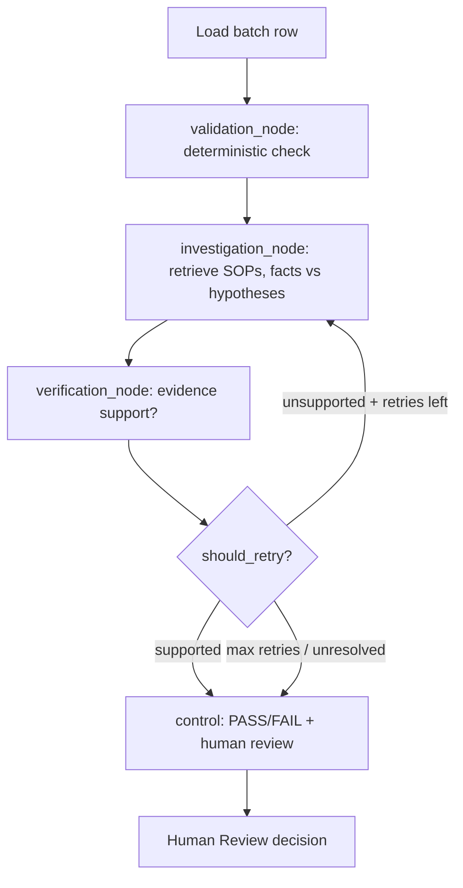

# Manufacturing Quality Intelligence — Agentic AI System (Demo)

> **Fictional demo only.** All batch data in `data/quality_batches.csv`, limits in
> `config/demo_quality_limits.yaml`, and SOPs in `data/sops/` are **synthetic training
> examples**. They are **NOT real Shivam Proteco company data** and **NOT official
> industrial specifications**.

Interview-ready Agentic AI app for manufacturing quality inspection:
deterministic validation of aluminium powder + plastic component batches,
SOP retrieval (RAG), failure investigation, evidence verification, bounded retries,
and mandatory human review. No autonomous batch release. LLM never overrides numerics.

## Architecture

```
CSV ──► QualityValidator (deterministic) ──► InvestigationAgent (SOP RAG: facts vs hypotheses)
            │                                            │
            │                                     VerificationAgent (evidence support?)
            │                                            │
            └──────────── Controller (max 3 retries) ────┴──► Human Review (mandatory)
                                    │                              │
                              ChromaDB (vectors)               FastAPI + HTML/CSS/JS
                              SQL optional (records)           (REST + dashboard)
```

### Mermaid workflow



## Project structure

```
.
├── main.py                     # CLI: validate / test / api / dashboard / ingest / demo
├── pyproject.toml
├── .env.example
├── frontend/                   # Static web UI (HTML/CSS/JS, no build step)
│   ├── index.html
│   ├── styles.css
│   └── app.js
├── config/
│   └── demo_quality_limits.yaml  # FICTIONAL demo limits
├── data/
│   ├── quality_batches.csv     # PRESERVED user data (50 demo batches)
│   └── sops/
│       ├── sop_quality_inspection.md  # SYNTHETIC SOP-001
│       └── sop_nonconformance.md      # SYNTHETIC SOP-002
├── src/
│   ├── config/settings.py
│   ├── models/schemas.py
│   ├── quality/validator.py
│   ├── rag/ingestion.py + retriever.py
│   ├── agents/investigation_agent.py + verification_agent.py
│   ├── graph/state.py + nodes.py + workflow.py
│   ├── database/connection.py + models.py + repositories.py + vector_store.py (ChromaDB)
│   ├── services/quality_service.py
│   ├── api/app.py + routes.py   # REST API + serves frontend/ at /
│   └── frontend/__init__.py
└── tests/
    ├── unit/test_validator.py + test_rag.py + test_workflow.py + test_chroma.py + test_database.py
    └── integration/test_api_db.py
```

## Dataset schema (`data/quality_batches.csv`)

| column | meaning |
|---|---|
| batch_id | e.g. B001 |
| product_type | aluminium_powder \| plastic_component |
| purity_pct | N/A for plastic; never 0 |
| moisture_pct | N/A for plastic |
| particle_size_um | N/A for plastic |
| defect_count | integer ≥ 0 |
| inspection_status | recorded PASS/FAIL/REVIEW (NOT source of truth) |

Fictional demo limits: aluminium `purity ≥ 99.0`, `moisture ≤ 0.10`, `particle 10–50 um`;
plastic `defect_count ≤ 0`. Missing/invalid → REVIEW; unknown type → REVIEW; negative/malformed never discarded.

### Optional ai4i2020.csv
If present, `data/ai4i2020.csv` is left intact and treated as **optional, separate public
predictive-maintenance data** (machine failure labels), NOT product-quality data.
Never required for core validation. Do not mix its labels with quality labels.

## Windows 11 PowerShell setup

```powershell
python -m venv .venv
.venv\Scripts\Activate.ps1
python -m pip install --upgrade pip
pip install -e ".[test]"
```

Base env already has Python 3.14.6 — no fresh Python install needed; just create/activate the venv.
Minimal offline run needs only: `pandas pyyaml pydantic pytest`.

## Running CSV validation (no API key, no DB)

```powershell
python main.py
python main.py validate --csv data/quality_batches.csv
python main.py demo --batch B002
python main.py test
```

## Configuring the LLM provider (Groq live, rule-based fallback)

```powershell
Copy-Item .env.example .env
# edit .env:
# LLM_PROVIDER=groq  + GROQ_API_KEY=...  (live LLM-drafted hypotheses)
# LLM_PROVIDER=none   (default rule-based demo mode)
pip install groq   # required only for live mode
```

`.env` is auto-loaded. When Groq is reachable, the investigation agent sends
deterministic facts + SOP excerpts to Groq to draft hypotheses and recommended
next steps (`demo_mode=False`, model recorded); the calculated PASS/FAIL/REVIEW
is never modified by the LLM. When Groq is unreachable (no key, no package, no
network), the run falls back to rule-based text and says so honestly in the
summary — it never pretends an LLM ran.

## Persistence: SQLite + ChromaDB (no server needed)

Relational records (batches/results/reviews) use SQLite
(`sqlite:///data/quality.db`, file-based, no server). Every investigation run
persists its validation, investigation, and verification rows; reviews persist
via `POST /batches/{id}/review`. SOP vectors use local
ChromaDB at `CHROMA_DIR` (default `data/chroma`) — no server required — and the
investigation agent retrieves through this vector store first (keyword fallback).

```powershell
# Ingest SOPs into ChromaDB + SQLite metadata (idempotent):
python main.py ingest
```

Schema init via `init_schema()` uses `create_all(checkfirst=True)` — never drops data.

## SOP ingestion

```powershell
python main.py ingest
```

Idempotent (chunk_id = sha256 hash). Preserves title/section/document_id/version. Returns citations.

## Starting the API + web frontend (HTML/CSS/JS)

```powershell
python main.py api          # API + frontend at http://127.0.0.1:8000/ (docs: /docs)
python main.py dashboard    # same server + auto-opens the frontend in your browser
```

The frontend is plain HTML/CSS/JS in `frontend/` (no npm, no build step),
served same-origin by FastAPI. It shows batch counts, filters, measurements,
failed checks, recorded-vs-calculated status, SOP evidence with citations,
investigation/verification results, retry counts, and the human-review form.

Endpoints: `GET /health`, `GET /summary`, `GET /batches`, `GET /batches/{id}`,
`POST /batches/{id}/validate`, `POST /batches/{id}/investigate`,
`GET /batches/{id}/history`, `POST /batches/{id}/review`, `POST /documents/ingest`.

## Running tests

```powershell
python -m pytest -q
python main.py test
```

Unit tests run offline (no keys/network/GPU/DB). Integration tests skip without server/DB.

## Troubleshooting

| issue | fix |
|---|---|
| `CSV not found` | check `--csv` path; default `data/quality_batches.csv` |
| `No module named pandas` | activate `.venv`, `pip install -e ".[test]"` |
| `langgraph` missing | fallback sync workflow auto-used; install to test real graph |
| DB errors | check `data/quality.db` permissions; delete it to reset demo records (never production data) |
| Groq fail | check `GROQ_API_KEY` in `.env`, model name, and network access |

## Five-minute interview demo script

1. (30s) Disclaimer: synthetic data + fictional limits.
2. (60s) `python main.py` — show PASS/FAIL/REVIEW counts + discrepancies.
3. (60s) `python main.py demo --batch B002` — deterministic FAIL (purity), SOP citations, verification, human-review routing.
4. (60s) `python main.py demo --batch B004` — plastic PASS; `B007`-style REVIEW case.
5. (60s) API `/docs` → investigate + review endpoints; dashboard filters + evidence citations.
6. (30s) `python -m pytest -q` — offline green; bounded retries (max 3), LLM never overrides numerics.

## Interview Q&A

**Why deterministic validator first?** LLM must never override numerics; reproducibility + auditability. Agents only explain, verify cites evidence.

**How do you prevent hallucinated citations?** Retriever returns only real chunks with title/section/ID/version; empty → explicit "no evidence"; verifier rejects unsupported claims.

**What bounds the loop?** `max_retries=3`, `should_retry()` routes done/retry/review; unresolved → human review; `requires_human_review=True` always.

**How does it run without DB/LLM?** `FakeRetriever` + rule-based agents + sync fallback workflow; DB/LLM are optional facades. Tests assert `demo_mode=True`.

**Why mandatory human review?** System never autonomously releases batches; even PASS needs authorized disposition + comments, persisted when DB configured.

**N/A handling?** Parsed as missing, never zero; missing required → REVIEW, never silent drop.
